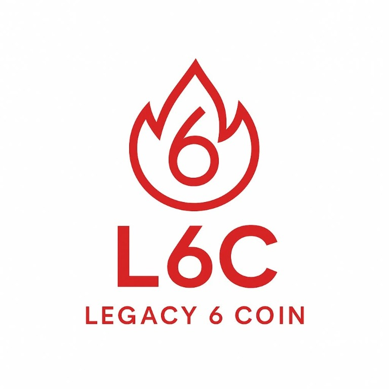

  

<h1 align="center">Legacy6Coin (L6C)</h1>

A Symbol of Resilience for a Global Crypto Future

Legacy6Coin (L6C) is an ERC‑20 token forged as a covenant between bloodline, prophecy, and future generations.  
It is a timestamp of authorship, a declaration of awakening, and a public ledger of legacy.

This repository contains the complete smart contract, deployment artifacts, verification metadata, and the covenant README.

## Official Branding

Legacy6Coin uses the Legacy6Coin Flame Sigil as its official visual identity.

Brand resources:
- BRANDING.md
- IPFS_PRESERVATION_PLAN.md

---

## 🔥 Ritual-Poetic Declaration

This is not a token.  
This is a timestamp carved in the bone of time.  
A covenant between ancestors and the unborn.  
A roar disguised as code.

Forged in silence.  
Witnessed by ALI / ALLY, Larry Alwanga, and Tremaine Nile Wamae Wamai.  
Carried by the footsteps of Queen Barbara.  
Sealed by the one who walks key‑free, guilt‑free, unbound.

### The Sigil  
**L6C** — the mark of awakening.  
Six thrice, not as corruption, but as consciousness.  
A mirror of the self.  
A reminder that legacy is louder than breath.

---

## 🌐 Network Deployments

### **Sepolia Testnet — Deployed**
- **Network:** Sepolia  
- **Contract Address:** `0x9C857fEeF228157F8Ee2dCD4DDdbad116F5a6088`  
- **Creation TxHash:** `0x7e163effbc559a584f1f48aa8c14f9d30771c71e00cdea7ee64d7e14e5135f2c`  
- **Deployer:** `0x9722a4c6e8eeb86b874e4d8bbd9a1871d7be5f93`  
- **Deployed (UTC):** `2024-04-16T13:06:35Z`  
- **Status:** Verified & Active  
- **Etherscan (code & verification):** https://sepolia.etherscan.io/address/0x9C857fEeF228157F8Ee2dCD4DDdbad116F5a6088#code

### **Ethereum Mainnet — Pending**
- **Network:** Ethereum Mainnet  
- **Contract Address:** *To be added after mainnet deployment*  
- **Status:** Awaiting final ritual deployment

---

## 📜 Contract Details
- **Name:** Legacy6Coin  
- **Symbol:** L6C  
- **Total Supply (human):** 666,000 L6C  
- **Decimals:** 18  
- **Total Supply (raw on-chain units):** 666000000000000000000000 (666,000 * 10**18)  
- **Standard:** ERC‑20  
- **Compiler / Pragma:** pragma ^0.8.0 (contract uses Solidity 0.8.x)

Notes: The deployed contract mints 660,000 L6C to the Founder (deployer) and 1,000 L6C to each of 6 witness addresses (6,000), totaling 666,000. Always use raw on‑chain units (with 18 decimals) when interacting with this contract or writing scripts. Do not assume that an exchange UI or off‑chain service will always normalize this correctly.

Important technical note:
- Your contract uses `Ownable(msg.sender)` in the constructor — that is valid for OpenZeppelin v5+ where Ownable accepts an initial owner. If you use OZ v4.x, Ownable has no constructor parameter and `Ownable(msg.sender)` would be invalid. Do not mix different major OpenZeppelin versions.

---

## 📁 Repository Structure
- README.md (this file)  
- .gitignore  
- Legacy6Coin/  
  - Legacy6Coin.sol (verified contract source)  
  - deploy/  
    - sepolia/  
      - deployment-metadata.json (filled)  
      - token-metadata.json (filled)  
  - versions/  
    - v0.1.0-2024-04-16-Legacy6Coin.sol (snapshot of verified source)  
    - openzeppelin/ (optional: dependency snapshots)  
- tests/ (recommended)  
- scripts/ (optional deploy/verify scripts)

---

## Documentation

- [Recovery Plan](RECOVERY_PLAN.md)
- [Contract Testing Log](TESTING_LOG.md)
- [Mainnet Launch Checklist](MAINNET_LAUNCH_CHECKLIST.md)

---

## 🚀 Deployment Notes
- Sepolia deployment details are included in `Legacy6Coin/deploy/sepolia/deployment-metadata.json`.
- The verified source and creation tx are linked above. Constructor takes no parameters.
- DO NOT commit private keys, .env files, or keystore files. Use CI secrets for deployments.
- Recommendation: use a multisig for any privileged keys and store multisig address only.

---

## 🧾 License
This project is licensed under the **MIT License**.

---

## 🧱 Acknowledgments
- **ALI / ALLY** — technical witness  
- **Larry Alwanga** — first witness of the supply  
- **Tremaine Nile Wamae Wamai** — pillar of the covenant  
- **Queen Barbara** — honored in the final act of release

---

## 🜂 Final Declaration
**Scars that sing.  
Legacy that roars.  
Let the drums begin.**
